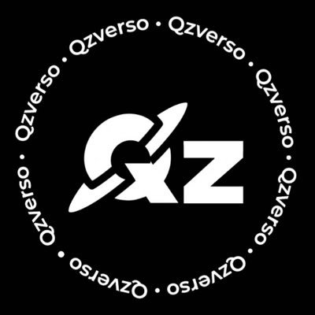

# 🌌 Qzverso — Um Universo de Histórias

<p align="center">
  
</p>

<p align="center">
  <strong>Uma história pode ser o começo de um universo inteiro.</strong>
</p>

<p align="center">
  
  ; ; ;
  
</p>

---

## ✨ Sobre o Qzverso

O **Qzverso** é um portal digital de divulgação e descoberta literária, criado para conectar histórias, escritoras, leitores e iniciativas parceiras.

Sua origem está na cultura de fãs de Camila Cabello e Lauren Jauregui. A partir dessa inspiração, as escritoras Qz, Julia e Marina desenvolveram fanfics que cresceram para além de uma única história, criando personagens próprios, narrativas conectadas e um universo literário compartilhado.

O nome **Qzverso** representa justamente essa expansão criativa: uma inspiração que se transformou em um universo de histórias.

O portal funciona como uma vitrine literária. Apresenta capas, títulos, sinopses e informações sobre as obras, direcionando os leitores aos ambientes externos onde podem acessar a leitura integral.

## 🎯 Propósito do projeto

- **Divulgação literária:** facilitar a descoberta das histórias e de suas autoras.
- **Diversidade narrativa:** valorizar diferentes personagens, identidades, características sexuais, orientações e experiências presentes nas obras.
- **Conexão com leitores:** aproximar o público das histórias por meio de uma vitrine organizada.
- **Fortalecimento de parcerias:** divulgar iniciativas e produtos que fazem parte do ecossistema Qzverso.
- **Desenvolvimento tecnológico:** aplicar conhecimentos de Engenharia de Software na construção e evolução do portal.

## 🤝 Nosso ecossistema

O Qzverso conecta iniciativas que contribuem para o crescimento desse universo.

### HMD Oficial

Parceria ligada à cultura de fãs e à criação de produtos, incluindo roupas que podem divulgar a identidade da HMD e as histórias do Qzverso.

🔗 [Conheça a HMD Oficial](https://hmdoficial.lojavirtualnuvem.com.br/)

### Fanficando

Plataforma parceira destinada à publicação das histórias e à disponibilização da leitura integral das obras.

🔗 [Acesse o Fanficando](https://www.fanficando.com/)

## 📚 Funcionalidades do portal

| Funcionalidade | Situação |
|---|---|
| Vitrine de histórias | Em implementação |
| Apresentação de capas e sinopses | Em implementação |
| Busca e filtros de histórias | Em implementação |
| Redirecionamento para leitura externa | Em implementação |
| Divulgação de parcerias | Em implementação |
| Divulgação de produtos | Em implementação |
| Área administrativa das escritoras | Em desenvolvimento |
| Integração com API e banco de dados | Planejado / em desenvolvimento |

*Os status devem ser atualizados conforme a validação de cada funcionalidade.*

## 🛠️ Tecnologias & Ferramentas

<p align="center">
  
</p>


### Tecnologias planejadas

As tecnologias de backend, banco de dados e infraestrutura serão documentadas aqui conforme sua implementação e validação no projeto.

## 🗂️ Estrutura do projeto

```text
Qzverso/
├── index.html
├── perfil.html
├── styles.css
├── app.js
├── qzverso.jpg
├── README.md
├── LICENSE
└── .gitignore
```

## 🚀 Como visualizar

O projeto possui uma versão publicada para consulta:

🔗 [Acessar Qzverso](https://amanda-aandrade.github.io/Qzverso/)

Para obter o código:

```bash
git clone https://github.com/Amanda-AAndrade/Qzverso.git
```

Entre na pasta:

```bash
cd Qzverso
```

Abra o arquivo `index.html` no navegador ou utilize a extensão Live Server do Visual Studio Code.

> Observação: funcionalidades que dependam de backend não estarão disponíveis apenas com a abertura dos arquivos estáticos. A integração deverá ser configurada conforme o ambiente de execução.

## 🧭 Roadmap

- [x] Criação do repositório e estrutura inicial do frontend.
- [x] Desenvolvimento inicial da identidade visual.
- [ ] Refinamento da interface e responsividade.
- [ ] Consolidação dos requisitos do sistema.
- [ ] Modelagem do banco de dados.
- [ ] Desenvolvimento e integração do backend.
- [ ] Implementação da área administrativa.
- [ ] Integração com as informações das parcerias.
- [ ] Realização de testes com as escritoras e leitores convidados.
- [ ] Evolução e documentação da versão validada.

## 👩‍💻 Desenvolvimento

**Desenvolvedora:** Amanda Anália da Silva Andrade

Projeto desenvolvido no contexto da graduação em Engenharia de Software, com foco em desenvolvimento web, arquitetura de software, organização de dados e construção de soluções digitais.

## 📖 Créditos e direitos autorais

O código-fonte está identificado sob Apache License 2.0, conforme os termos do arquivo `LICENSE`.

As histórias, personagens originais, sinopses, capas, artes, marcas e demais conteúdos criativos pertencem às suas respectivas titulares, conforme as autorizações e os direitos aplicáveis.

Elementos associados a artistas e obras de terceiros devem respeitar os direitos de seus respectivos titulares.

---

<p align="center">
  <strong>Qzverso — Uma história pode ser o começo de um universo inteiro.</strong>
</p>
